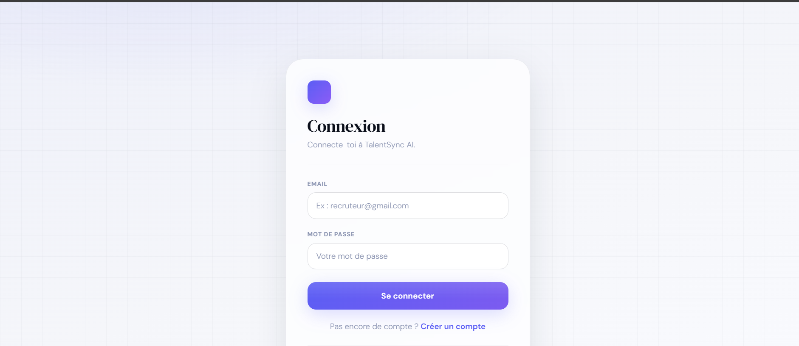
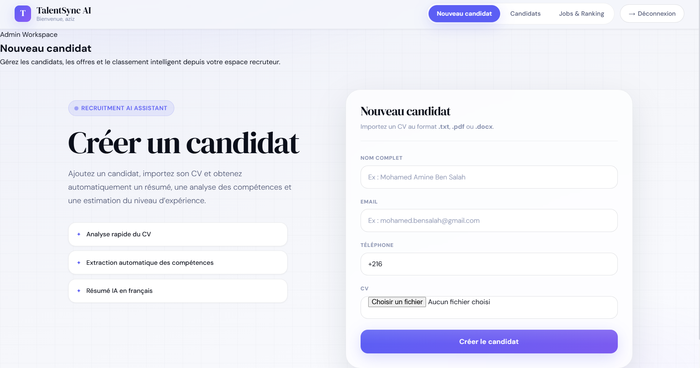
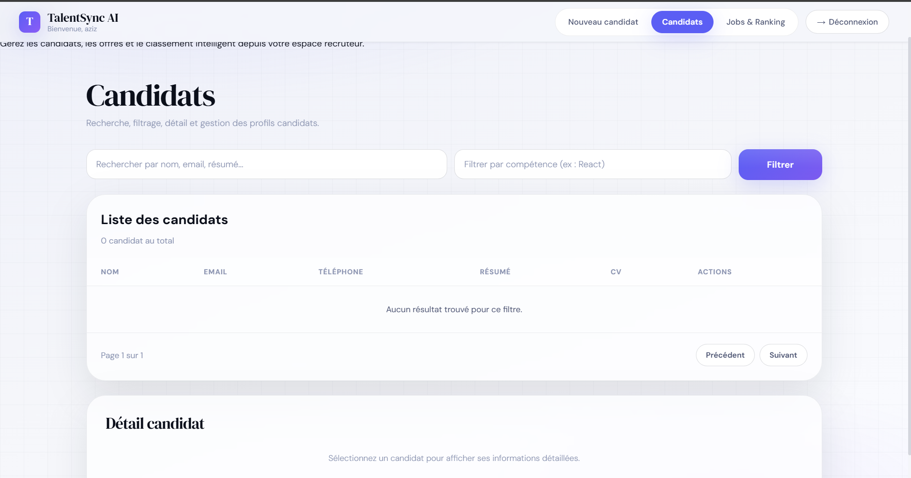
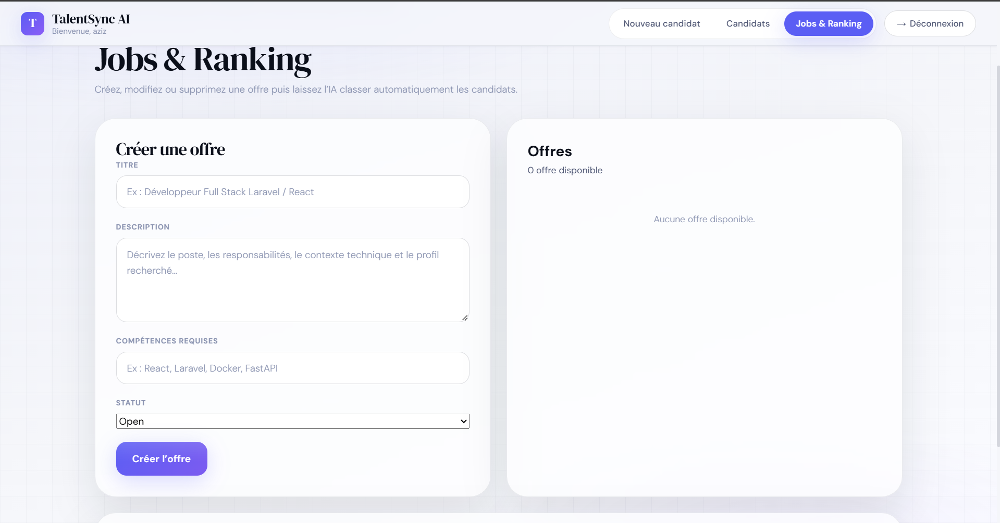

# TalentSync AI

**TalentSync AI** is a recruitment web platform designed to simplify candidate management and to assess how well candidates match job offers.

The platform allows recruiters to centralize applications, automatically extract key information from resumes, analyze candidates' skills and experience, and rank them according to their fit with a given job offer.

> Project carried out during the **2025 – 2026** academic year by **Mohamed Aziz Hammami** and **Houssem Soltani**.

---

## Table of Contents

* [Overview](#overview)
* [Features](#features)
* [Architecture](#architecture)
* [Functional Flows](#functional-flows)
* [Tech Stack](#tech-stack)
* [Repository Structure](#repository-structure)
* [Prerequisites](#prerequisites)
* [Installation](#installation)
* [Configuration](#configuration)
* [Running the Project](#running-the-project)
* [API Reference](#api-reference)
* [Scoring Engine](#scoring-engine)
* [Data Model](#data-model)
* [Screenshots](#screenshots)
* [Known Limitations](#known-limitations)
* [Planned Improvements](#planned-improvements)
* [Security](#security)
* [Authors](#authors)

---

## Overview

TalentSync AI is a web application built to support recruiters in managing and pre-screening candidates.

When a candidate is added, their resume can be uploaded directly to the platform. The backend then extracts the text content of the document and sends the information to the FastAPI analysis service.

The analysis service identifies, in particular:

* technical skills;
* soft skills;
* languages;
* experience level;
* an estimate of years of experience;
* job roles that may fit the profile;
* a professional summary.

For each job offer, the platform can then compute a **matching score** for the available candidates and generate a ranking that lets the recruiter quickly identify the most suitable profiles.

The current matching engine relies on **explicit, deterministic scoring rules**. The Groq API is used to generate the professional summary when it is available.

---

## Features

### Authentication

* User registration
* Login
* Logout
* Token-based authentication with Laravel Sanctum

### Candidate Management

* Candidate creation
* Resume upload
* Automatic extraction of resume content
* Candidate browsing
* Search by name or text-based information
* Filtering by skill
* Pagination
* Candidate deletion
* Associated resume deletion

### Resume Analysis

Currently supported formats:

* `.pdf`
* `.docx`
* `.txt`

The analysis extracts, in particular:

* technical skills;
* behavioral skills;
* languages;
* experience level;
* estimated years of experience;
* recommended roles;
* professional summary.

### Job Offer Management

* Job offer creation
* Job offer browsing
* Job offer editing
* Job offer deletion
* Required skills management
* Job offer status management

### Candidate Ranking

For a given job offer, the system computes:

* the overall score;
* matching skills;
* missing skills;
* estimated experience;
* experience level;
* an assessment of the level of fit.

### Data Validation

The phone number is validated against the Tunisian format:

```text
+216XXXXXXXX
```

with eight digits after the `+216` prefix.

---

# Architecture

TalentSync AI is made up of three main services:

```text
                         HTTP / JSON
┌─────────────────────┐  ──────────────►  ┌──────────────────────┐
│                     │                   │                      │
│  React Frontend     │                   │  Laravel Backend     │
│                     │  ◄──────────────  │                      │
│  React + TypeScript │                   │  REST API            │
│  Vite               │                   │  Sanctum             │
│                     │                   │  SQLite              │
└─────────────────────┘                   └──────────┬───────────┘
                                                     │
                                                     │ HTTP / JSON
                                                     ▼
                                          ┌──────────────────────┐
                                          │                      │
                                          │  FastAPI Service     │
                                          │                      │
                                          │  Resume analysis     │
                                          │  Matching            │
                                          │  Scoring             │
                                          │                      │
                                          └──────────┬───────────┘
                                                     │
                                                     ▼
                                                 Groq API
                                            Summary generation
```

### Frontend

The frontend is the interface used by the recruiter.

It allows, in particular:

* registration and login;
* candidate creation;
* resume upload;
* candidate browsing;
* job offer creation and management;
* viewing the ranking.

Main technologies:

* React
* TypeScript
* Vite
* Axios

### Backend

The Laravel backend is the core of the application.

It handles, in particular:

* authentication;
* user management;
* candidate management;
* job offer management;
* data persistence;
* resume extraction;
* document storage;
* communication with FastAPI;
* score storage.

### FastAPI Service

The FastAPI service is dedicated to analysis tasks.

It provides, in particular:

* resume text analysis;
* skill identification;
* experience estimation;
* summary generation;
* matching computation between a candidate and a job offer.

---

# Functional Flows

## Adding a Candidate

```text
Recruiter
   │
   ▼
Candidate form
   │
   ▼
Resume upload
   │
   ▼
Laravel Backend
   │
   ├── Resume storage
   │
   └── Text extraction
           │
           ▼
      FastAPI Service
           │
           ├── Skills
           ├── Soft skills
           ├── Languages
           ├── Experience
           └── Summary
           │
           ▼
      Laravel / SQLite
           │
           ▼
      React Interface
```

## Ranking Candidates

```text
Job offer
      │
      ▼
Laravel
      │
      ├── Candidate 1 ──► FastAPI ──► Score
      ├── Candidate 2 ──► FastAPI ──► Score
      ├── Candidate 3 ──► FastAPI ──► Score
      └── ...
                │
                ▼
        Descending sort
                │
                ▼
        Candidate ranking
```

---

# Tech Stack

| Layer                      | Technologies                            |
| -------------------------- | --------------------------------------- |
| Frontend                   | React 19, TypeScript, Vite, Axios       |
| Backend                    | PHP 8.3, Laravel 13, Laravel Sanctum    |
| Database                   | SQLite                                  |
| PDF extraction             | `smalot/pdfparser`                      |
| DOCX extraction            | `phpoffice/phpword`                     |
| Analysis service           | Python 3.11, FastAPI, Pydantic, Uvicorn |
| Summary generation         | Groq API                                |
| Default model              | `llama-3.3-70b-versatile`               |
| PHP dependency management  | Composer                                |
| JS dependency management   | npm                                     |

---

# Repository Structure

```text
TalentSync-AI/
│
├── ai-service-fastapi/
│   ├── app/
│   │   └── main.py
│   └── requirements.txt
│
├── backend-laravel/
│   ├── app/
│   │   ├── Http/
│   │   │   └── Controllers/
│   │   │       ├── AiController.php
│   │   │       ├── AuthController.php
│   │   │       ├── CandidateController.php
│   │   │       └── JobController.php
│   │   │
│   │   ├── Models/
│   │   │   ├── Candidate.php
│   │   │   ├── Job.php
│   │   │   ├── MatchScore.php
│   │   │   └── User.php
│   │   │
│   │   └── Services/
│   │       └── FastApiService.php
│   │
│   ├── database/
│   │   └── migrations/
│   │
│   ├── routes/
│   │   ├── api.php
│   │   └── web.php
│   │
│   ├── composer.json
│   └── ...
│
├── frontend-react/
│   ├── src/
│   │   ├── api/
│   │   │   └── axios.ts
│   │   ├── pages/
│   │   │   ├── CandidatesPage.tsx
│   │   │   ├── CreateCandidatePage.tsx
│   │   │   ├── JobsPage.tsx
│   │   │   ├── LoginPage.tsx
│   │   │   ├── RegisterPage.tsx
│   │   │   └── UploadCvPage.tsx
│   │   ├── App.tsx
│   │   ├── App.css
│   │   └── main.tsx
│   │
│   ├── package.json
│   └── ...
│
├── screenshots/
│   ├── candidates.png
│   ├── dashboard.png
│   ├── jobs-ranking.png
│   └── login.png
│
├── .gitignore
└── README.md
```

---

# Prerequisites

Before getting started, install:

* **PHP 8.3 or higher**
* **Composer 2**
* **Node.js 20 or higher**
* **npm**
* **Python 3.11 or higher**
* **Git**
* A Groq API key *(optional)*

Required PHP extensions:

* `mbstring`
* `zip`
* `xml`
* `zlib`

On Windows, **Laravel Herd** can be used to simplify running the Laravel backend.

---

# Installation

## 1. Clone the Project

```bash
git clone https://github.com/aziz11414/TalentSync-AI.git
cd TalentSync-AI
```

---

## 2. Install the Laravel Backend

```bash
cd backend-laravel
composer install
```

Create the environment file:

### Windows

```cmd
copy .env.example .env
```

### Linux / macOS

```bash
cp .env.example .env
```

Generate the Laravel application key:

```bash
php artisan key:generate
```

Create the database and run the migrations:

```bash
php artisan migrate
```

Create the symbolic link to the storage directory:

```bash
php artisan storage:link
```

---

## 3. Install the FastAPI Service

From the project root:

```bash
cd ai-service-fastapi
```

Create the virtual environment:

```bash
python -m venv venv
```

### Windows

```cmd
venv\Scripts\activate
```

### Linux / macOS

```bash
source venv/bin/activate
```

Install the dependencies:

```bash
pip install -r requirements.txt
```

---

## 4. Install the React Frontend

```bash
cd ../frontend-react
npm install
```

---

# Configuration

## Laravel Backend

The main configuration file is:

```text
backend-laravel/.env
```

Key variables:

| Variable        | Value                   | Description                |
| --------------- | ----------------------- | -------------------------- |
| `APP_URL`       | Backend URL             | URL used by Laravel        |
| `DB_CONNECTION` | `sqlite`                | Database                   |
| `FASTAPI_URL`   | `http://127.0.0.1:8000` | Address of the FastAPI service |

Example:

```env
APP_URL=http://backend-laravel.test
DB_CONNECTION=sqlite
FASTAPI_URL=http://127.0.0.1:8000
```

> The value of `APP_URL` must match the address actually used by your Laravel installation.

---

## FastAPI Service

Create:

```text
ai-service-fastapi/.env
```

Example:

```env
GROQ_API_KEY=your_api_key
GROQ_MODEL=llama-3.3-70b-versatile
```

The Groq key is optional.

If it is not available, the service falls back to a local summary generation mechanism.

**Never commit this `.env` file.**

---

## React Frontend

The API address is defined in:

```text
frontend-react/src/api/axios.ts
```

Example:

```ts
const api = axios.create({
  baseURL: "http://backend-laravel.test/api",
});
```

The frontend origin must be allowed by the backend's CORS configuration.

---

# Running the Project

The project requires three services to be running.

## 1. Laravel Backend

With Laravel Herd, the backend can be available, for example, at:

```text
http://backend-laravel.test
```

Without Herd:

```bash
cd backend-laravel
php artisan serve --port=8081
```

In that case, the frontend API URL must be adjusted:

```text
http://127.0.0.1:8081/api
```

---

## 2. FastAPI Service

In a second terminal:

```bash
cd ai-service-fastapi
```

Activate the virtual environment.

### Windows

```cmd
venv\Scripts\activate
```

Then:

```bash
uvicorn app.main:app --reload --port 8000
```

The service is available at:

```text
http://127.0.0.1:8000
```

Interactive documentation:

```text
http://127.0.0.1:8000/docs
```

---

## 3. React Frontend

In a third terminal:

```bash
cd frontend-react
npm run dev
```

The frontend is available at:

```text
http://localhost:5173
```

---

# API Reference

## Laravel API

Prefix:

```text
/api
```

### Authentication

| Method  | Endpoint    | Description          |
| ------- | ----------- | -------------------- |
| `POST`  | `/register` | Create an account    |
| `POST`  | `/login`    | Log in               |
| `GET`   | `/me`       | Authenticated user   |
| `POST`  | `/logout`   | Log out              |

### Candidates

| Method   | Endpoint           | Description            |
| -------- | ------------------ | ---------------------- |
| `GET`    | `/candidates`      | Paginated list         |
| `POST`   | `/candidates`      | Create a candidate     |
| `GET`    | `/candidates/{id}` | Candidate details      |
| `DELETE` | `/candidates/{id}` | Delete a candidate     |

Available search parameters:

```text
q
skill
page
per_page
```

### Job Offers

| Method   | Endpoint             | Description              |
| -------- | -------------------- | ------------------------ |
| `GET`    | `/jobs`              | List job offers          |
| `POST`   | `/jobs`              | Create                   |
| `GET`    | `/jobs/{id}`         | Details                  |
| `PUT`    | `/jobs/{id}`         | Update                   |
| `DELETE` | `/jobs/{id}`         | Delete                   |
| `GET`    | `/jobs/{id}/ranking` | Candidate ranking        |

### Analysis

| Method  | Endpoint        | Description                    |
| ------- | --------------- | ------------------------------ |
| `POST`  | `/ai/upload-cv` | Analyze a resume               |
| `GET`   | `/ai/health`    | Analysis service status        |

---

# FastAPI API

| Method  | Endpoint               | Description                  |
| ------- | ---------------------- | ---------------------------- |
| `GET`   | `/health`              | Service health check         |
| `POST`  | `/parse-cv`            | Analyze a resume             |
| `POST`  | `/match-candidate-job` | Candidate / job offer matching |

Interactive documentation:

```text
http://127.0.0.1:8000/docs
```

---

# Example `/parse-cv` Response

```json
{
  "summary": "Développeur confirmé spécialisé en React et Laravel...",
  "skills": [
    "React",
    "Laravel",
    "JavaScript"
  ],
  "soft_skills": [
    "Communication"
  ],
  "languages": [
    "Français",
    "Anglais"
  ],
  "experience_level": "Intermédiaire",
  "years_of_experience_estimate": 3,
  "recommended_roles": [
    "Développeur Full Stack"
  ]
}
```

> Note: the textual values returned by the service (summary, languages, experience level, roles, notes) are currently in French.

---

# Example `/match-candidate-job` Response

```json
{
  "score": 42.0,
  "matched_skills": [
    "React",
    "Laravel"
  ],
  "missing_skills": [
    "FastAPI",
    "Docker"
  ],
  "candidate_skills": [
    "React",
    "Laravel",
    "JavaScript",
    "REST API"
  ],
  "required_skills": [
    "React",
    "Laravel",
    "FastAPI",
    "Docker"
  ],
  "experience_level": "Intermédiaire",
  "years_of_experience_estimate": 3,
  "notes": "Profil encore peu aligné avec ce poste."
}
```

---

# Scoring Engine

The current matching engine uses **explicit rules**. It is not based on a trained Machine Learning model.

The language model is used only to generate the candidate's professional summary when the Groq API is available.

## Score Computation

The final score is capped between **0 and 100**.

| Component         | Calculation                                              |
| ----------------- | -------------------------------------------------------- |
| Skills            | `(matched skills / required skills) × 75`                |
| Common keywords   | `+2.5` per shared keyword                                |
| Experience        | `min(years × 2, 15)`                                     |
| Senior bonus      | `+5` when the conditions are met                         |
| Penalty           | `min(missing skills × 2, 10)`                            |

The keywords used include, in particular:

```text
senior
lead
manager
api
backend
frontend
full stack
mobile
```

## Interpretation

|      Score | Interpretation                         |
| ---------: | -------------------------------------- |
| `85 – 100` | Excellent fit for the position         |
|  `70 – 84` | Very good profile with minor gaps      |
|  `50 – 69` | Generally compatible profile           |
|     `< 50` | Profile still poorly aligned           |

---

# Data Model

| Table                    | Description                                      |
| ------------------------ | ------------------------------------------------ |
| `users`                  | Recruiter accounts                               |
| `candidates`             | Candidate information and extracted data         |
| `job_offers`             | Job offer information                            |
| `match_scores`           | Candidate / job offer matching scores            |
| `personal_access_tokens` | Laravel Sanctum authentication tokens            |

The Laravel migrations provide the structure required for data persistence.

---

# Screenshots

## Login



## Dashboard



## Candidate Management



## Job Offers and Ranking



---

# Known Limitations

## Security

Some security improvements are still required before production use:

* strengthen API route authentication;
* protect candidate and job offer routes with `auth:sanctum`;
* use private storage for resumes;
* control document downloads;
* remove the test routes intended for development;
* never commit `.env` files;
* immediately regenerate any API key that has been exposed.

---

## Resume Analysis

The current system also has some limitations:

* the skill vocabulary relies on a list defined in the code;
* a skill missing from this list may not be detected;
* the estimate of years of experience may produce errors in some cases;
* some keywords are currently matched by substring;
* `.docx` extraction may miss some complex content such as tables.

---

## Performance

When ranking, the backend currently calls the analysis service once for each candidate.

For a large number of candidates, this approach could be improved with:

* a queue system;
* result caching;
* persistence of computed scores;
* asynchronous processing;
* controlled parallelization of analyses.

---

# Planned Improvements

Planned improvements include, in particular:

* [ ] Candidate editing
* [ ] Linking candidates to the users who create them
* [ ] Linking job offers to the users who create them
* [ ] Using Vite environment variables for the API URL
* [ ] Frontend routing with `react-router-dom`
* [ ] Automated tests for Laravel
* [ ] Automated tests for FastAPI
* [ ] Improved scoring system
* [ ] Caching of matching results
* [ ] Asynchronous processing of analyses
* [ ] Private and secure resume storage
* [ ] Improved document extraction
* [ ] Evolution towards semantic comparison of profiles and job offers

---

# Security

Files containing sensitive information must never be added to the Git repository.

The project notably uses a `.gitignore` to exclude:

```text
.env
venv/
node_modules/
vendor/
storage/
*.sqlite
```

Before publishing the project, make sure that no API key, password, or other sensitive information is present in the files tracked by Git.

To check which `.env` files are tracked:

```bash
git ls-files | findstr /I ".env"
```

The following example file can be committed:

```text
backend-laravel/.env.example
```

Actual `.env` files must not be committed.

---

# Authors

### Mohamed Aziz Hammami

Platform development, architecture, and integration of the different services.

### Houssem Soltani

Development and contribution to the design of the recruitment platform.

---

# License

Academic project carried out during the **2025 – 2026** academic year.

Unless otherwise stated, this project is intended for academic and educational use.
