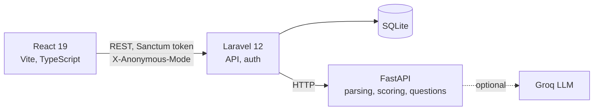

<div align="center">

# TalentSync AI

**Recruit faster, decide better.**

An applicant tracking system that parses resumes, scores candidates against job offers with a fully explainable algorithm, and keeps the recruiter in control.

[English](README.md) · [Français](README.fr.md)

[](https://github.com/USER/REPO/actions/workflows/ci.yml)


</div>

---

## Overview

A recruiter can receive hundreds of resumes for a single position. Sorting them by hand is slow, error-prone, and exposed to unconscious bias.

TalentSync AI addresses this in four steps:

1. **Ingest** resumes in PDF, DOCX or TXT and extract their text.
2. **Analyze** each profile: technical skills, soft skills, languages, seniority, years of experience, professional summary.
3. **Score** every candidate against every job offer, with a breakdown of how each point was earned or lost.
4. **Rank and track** candidates through a recruitment pipeline, with CSV export.

The tool ranks and suggests. It never rejects a candidate automatically.

## Features

| Area | Description |
|---|---|
| Resume parsing | PDF, DOCX and TXT upload (5 MB max), text extraction with PyMuPDF and python-docx |
| Profile analysis | Skills, soft skills, languages, seniority level, experience, summary |
| Explainable scoring | Deterministic score from 0 to 100 with an itemized breakdown: skills matched, experience bonus, keyword bonus, missing-skill penalty |
| Ranking | Candidates ordered by relevance for each job offer |
| Interview questions | Six questions calibrated to the candidate's level, with an evaluation grid for the interviewer |
| Anti-bias mode | Name, email and phone masked **by the API**, not only in the interface |
| Comparison | Side-by-side view of two candidates |
| Pipeline | New, In review, Interview, Hired, Rejected; dashboard with live KPIs |
| Search and export | Instant search by name, email, summary or skill; CSV export |
| Localization | Interface available in French and English |

## Screenshots

| | |
|---|---|
|  **Dashboard** |  **Job offers and ranking** |
|  **Score breakdown** |  **Interview questions** |
|  **Anti-bias mode** |  **Candidate comparison** |

## Architecture



| Service | Responsibility | Port |
|---|---|---|
| `frontend-react` | User interface, localization, state | 5173 |
| `backend-laravel` | REST API, authentication (Sanctum), persistence, anonymization | 8080 |
| `ai-service-fastapi` | Text extraction, profile analysis, scoring, interview questions | 8000 |

Laravel owns the API, authentication and data. FastAPI owns the document and scoring pipeline, where the Python ecosystem is strongest. The two can be tested and replaced independently.

## Scoring method

The score is deterministic and decomposable, so every point can be justified to a hiring manager. An opaque similarity score from embeddings would not allow that.

| Component | Weight | Notes |
|---|---|---|
| Hard-skill coverage | 60 % | Exact and token-overlap matching against required skills |
| Experience level | 25 % | Seniority alignment, with a bounded penalty |
| Secondary factors | 15 % | Technical keywords |

Missing mandatory skills reduce the score through a capped penalty, so one gap does not erase an otherwise relevant profile. The result is clamped between 0 and 100 and displayed with its full breakdown.

## Interview question generation

Questions are generated from the job title, the seniority level, the years of experience, the skills the candidate has and the skills they lack. No name, age or origin is sent to the model.

| Level | Max difficulty | Focus |
|---|---|---|
| Junior | 3 / 5 | Fundamentals, learning approach, handling blockers |
| Intermediate | 4 / 5 | Debugging, optimization, production incidents, testing, code review |
| Senior | 5 / 5 | Architecture, technical debt, technology choices, mentoring, trade-offs |

The language model proposes; the code validates:

- Strict Pydantic schema with six question types: technical, practical, architecture, scenario, behavioral, leadership.
- Difficulty capped by level; juniors receive no architecture question, seniors receive at least one.
- Skills are mapped to domains (frontend, backend, data, devops, mobile) and a coherence filter rejects cross-domain questions, such as distributed-systems questions about a UI library.
- Exactly six questions are returned: missing ones are completed from level-aware templates, extras are dropped.
- Full template fallback when the LLM is unavailable.

## Privacy and security

| Measure | Detail |
|---|---|
| Server-side anonymization | With the `X-Anonymous-Mode: 1` header, Laravel masks `full_name`, `email` and `phone` before serialization. The browser's network tab shows only neutral identifiers. |
| Resume excerpt scrubbing | Emails, phone numbers, URLs and name tokens are redacted before any text is sent to the LLM. |
| Prompt injection | Resume text is wrapped in `<cv_data>` tags and treated as data; model output is schema-validated. |
| Upload validation | PDF, DOCX and TXT only, 5 MB max, sanitized filenames with a unique suffix. |
| Authentication | Laravel Sanctum. |
| Human control | No automatic rejection. |

The project follows a privacy-by-design approach. It does not claim full GDPR compliance.

## Quick start

### Docker (recommended)

```bash
docker compose up --build
```

| Service | URL |
|---|---|
| Web application | http://localhost:5173 |
| Laravel API | http://127.0.0.1:8080 |
| FastAPI docs (Swagger) | http://127.0.0.1:8000/docs |

Stop with `docker compose down`.

### Local development (Windows)

```bash
run.bat
```

or, in PowerShell:

```powershell
.\run.ps1
```

This starts the three services with hot reload.

### Configuration

Each service ships a `.env.example`. Copy it to `.env` and adjust:

```bash
cp ai-service-fastapi/.env.example ai-service-fastapi/.env
cp backend-laravel/.env.example backend-laravel/.env
cp frontend-react/.env.example frontend-react/.env
```

The Groq API key is optional. Without it, the AI service uses its deterministic fallbacks. Never commit `.env` files.

### Demo account

For local demonstration only:

| Field | Value |
|---|---|
| Email | `demo@talentsync.ai` |
| Password | `password` |

The database is seeded with 12 fictitious candidates, 3 job offers and a populated pipeline. All names are fictional.

## Performance

Two measurements, taken on a local machine. Neither includes a remote LLM call.

| Measurement | Result | Script |
|---|---|---|
| Scoring and matching, 100 synthetic profiles, in memory | 0.29 s total, about 344 profiles/s, 2.89 ms mean (p50 2.66 ms, p95 3.44 ms) | `ai-service-fastapi/benchmark_100_cv.py` |
| Parsing, matching and question generation, 10 real resumes, no LLM | 0.09 s total, 9.2 ms per resume | `ai-service-fastapi/benchmark_e2e_10_cv.py` |

With the remote LLM enabled, total time per resume is dominated by network latency to the external API and has not been benchmarked. Figures above measure the deterministic engine, not the full LLM-assisted path.

## Testing

```bash
# AI service
cd ai-service-fastapi
pytest tests -v

# Scoring benchmark
python benchmark_100_cv.py

# Frontend type-check and production build
cd ../frontend-react
npm run build
```

The Pytest suite covers scoring bounds and penalties, experience bonus, French soft-skill extraction, empty-document resilience, level rules for interview questions and domain coherence. GitHub Actions runs the Python tests, the Laravel checks and the frontend build on every push.

## Project structure

```
.
├── ai-service-fastapi/   Parsing, scoring, interview questions, tests, benchmarks
├── backend-laravel/      REST API, Sanctum auth, anonymization, migrations, seeders
├── frontend-react/       React 19 interface, localization
├── docs/screenshots/     README images
├── docker-compose.yml
├── run.bat / run.ps1
└── LICENSE
```

## Engineering notes

**Heterogeneous resumes.** Multi-column layouts and graphic blocks scramble raw extraction. A preprocessing step built on PyMuPDF and python-docx removes non-printable artifacts, normalizes Unicode and standardizes section boundaries before analysis.

**Unreliable LLM output.** Models occasionally wrap JSON in markdown fences or add stray keys. Extraction runs at low temperature, responses go through a sanitizing step, and a strict Pydantic schema with safe defaults guards the rest.

**Explainability over embeddings.** A cosine similarity yields a single opaque number. A deterministic, itemized score was chosen so that a recruiter can audit every result.

**Anonymization that holds up.** Masking names in the interface leaves them visible in network requests. Masking in the API removes them from the response itself.

## Limitations

- No OCR: scanned resumes are not supported.
- LLM-assisted analysis depends on an external service and may carry the model's own biases; anonymization in the interface does not remove these.
- Regex-based scrubbing cannot guarantee removal of every contextual identifier, such as an uncommon employer name.
- Skill detection relies on a bounded vocabulary; synonyms and other languages need work.
- SQLite suits a demonstration, not production load.
- Scoring weights are fixed rather than configurable per offer.

## Roadmap

- OCR for scanned resumes
- Configurable scoring weights per job offer
- Duplicate resume detection
- Semantic search alongside the deterministic score
- PostgreSQL, consent management and automatic data retention
- Candidate evaluation against a hand-annotated resume set

## License

Released under the [MIT License](LICENSE).

## Author

**Mohamed Aziz Hammami** · [GitHub](https://github.com/USER)
