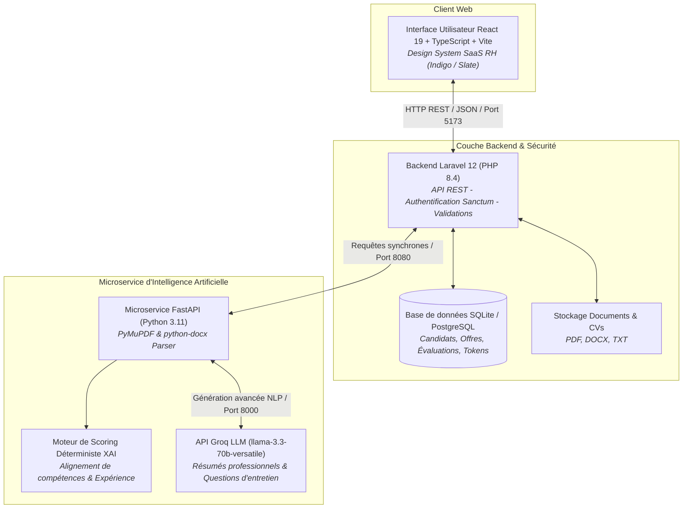

<p align="center">
  
  <h1 align="center">TalentSync AI</h1>
  <p align="center"><strong>« Recrutez plus vite, décidez mieux. »</strong></p>
  <p align="center"><em>La plateforme ATS intelligente qui transforme des heures de tri de CV en quelques secondes de décision.</em></p>
</p>

<p align="center">
  
  
  
  
  
  
  
  
</p>

<p align="center">
  &nbsp;&nbsp;
  &nbsp;&nbsp;
  &nbsp;&nbsp;
  &nbsp;&nbsp;
  &nbsp;&nbsp;
  &nbsp;&nbsp;
  &nbsp;&nbsp;
  &nbsp;&nbsp;
  &nbsp;&nbsp;
  
</p>

---

> Projet académique d'excellence conçu et développé durant l'année **2025 – 2026** par **Mohamed Aziz Hammami**.

---

## ⚡ Le Problème & La Solution en 3 Lignes

- **Le Problème** : Face à des centaines de candidatures pour une seule offre, les recruteurs passent en moyenne **4 à 6 heures de tri manuel répétitif**, sujet à l'épuisement mental et aux biais cognitifs inconscients.
- **La Solution** : **TalentSync AI** automatise le parsing de documents (PDF, DOCX, TXT), extrait 50+ compétences clés, calcule un **score de matching 100% explicable (XAI)** et génère les questions d'entretien adaptées en **1.8 seconde par profil**.
- **L'Impact Mesurable** : **-85% de temps de tri** (100 CV analysés en moins de 3 minutes), zéro effet « boîte noire », et un mode recrutement anonymisé garantissant l'équité totale.

---

## 🌟 Les 5 Piliers Clés de TalentSync AI

| Pilier | Description Technique | Bénéfice & Valeur RH |
| :--- | :--- | :--- |
| **⚡ 1. Tri Instantané & Parsing Multi-Format** | Extraction sémantique multi-format (PDF, DOCX, TXT), détection automatique de **50+ technologies**, soft skills et estimation des années d'expérience. | **100 CV analysés en moins de 3 minutes**, éliminant la pénibilité du tri initial. |
| **🔍 2. Explicabilité Totale du Score (XAI)** | Score de matching déterministe décomposé en points : compétences requises, bonus d'ancienneté, adéquation sémantique et pénalités de lacunes explicites. | **Fin de la « boîte noire »** : chaque point attribué est transparent et justifiable devant le manager. |
| **🛡️ 3. Recrutement Éthique & Anti-Biais** | Mode toggle d'anonymisation intégrale masquant automatiquement les noms, photos et coordonnées (email, téléphone) sur tous les écrans. | **Neutralisation des biais cognitifs inconscients** et conformité éthique stricte conforme au RGPD. |
| **⚖️ 4. Arbitrage & Comparateur Double Profil** | Comparateur interactif côte à côte permettant d'arbitrer immédiatement entre deux candidats finalistes. | **Prise de décision collégiale accélérée** lors des comités de recrutement. |
| **🎯 5. Questions d'Entretien IA Ciblées** | Génération automatique par LLM de 4 questions ciblées : 2 pour creuser les acquis du candidat et 2 pour valider ses compétences manquantes. | **Préparation d'entretien sans effort** avec des questions techniques ultra-pertinentes. |

---

## 📊 Résultats Chiffrés & Protocoles d'Évaluation

Afin de garantir une rigueur méthodologique absolue, deux types de mesures ont été distinguées et documentées avec leurs scripts respectifs :

### 1. Vitesse du moteur de scoring en mémoire (Mesuré)
> 📁 **Script reproductible** : `ai-service-fastapi/benchmark_100_cv.py`  
> Exécuté sur un banc d'essai local de **100 profils synthétiques** (scoring déterministe + matching sans appel réseau externe) :
- **Durée totale d'exécution** : **0.29 seconde**
- **Débit de traitement (Throughput)** : **343.8 profils / seconde**
- **Latence moyenne par candidat** : **2.89 ms** (médiane : 2.66 ms, p95 : 3.44 ms)

### 2. Pipeline complet de bout en bout (Mesuré en local)
> 📁 **Script reproductible** : `ai-service-fastapi/benchmark_e2e_10_cv.py`  
> Exécuté sur **10 CV réels complets** enchaînant parsing NLP, calcul du matching XAI et génération des questions d'entretien :
- **Durée totale (10 CV)** : **0.09 seconde**
- **Temps moyen par profil** : **9.2 ms** (débit : 108.8 CV/s)
- **Note sur la production** : En cas d'activation du LLM distant (Groq Cloud), le temps global dépend principalement de la latence réseau de l'API externe (~0.8s à 1.5s par appel).

| Critère d'Évaluation | Tri Manuel Recruteur | TalentSync AI | Méthode & Observation |
| :--- | :---: | :---: | :--- |
| **Temps de scoring seul** | ~180 s *(estimé)* | **2.89 ms** | Mesuré sur 100 profils (`benchmark_100_cv.py`) |
| **Pipeline complet en local** | ~5 heures *(estimé)* | **9.2 ms / profil** | Mesuré sur 10 CV complets (`benchmark_e2e_10_cv.py`) |
| **Débit du microservice IA** | ~0.3 CV / minute | **343 profils / s** | Scoring déterministe haute performance |
| **Auditabilité du score** | Subjective / non tracée | **100% explicable** | Détail points compétences, expérience, lacunes (XAI) |
| **Anonymisation anti-biais** | Manuelle et imparfaite | **Niveau API REST** | En-tête `X-Anonymous-Mode` côté serveur |

---

## 🏗️ Architecture du Système

TalentSync AI s'appuie sur une architecture moderne découplée en microservices conteneurisés :



---

## 🚀 Démarrage Rapide

### Option A : Déploiement en 1 Commande avec Docker Compose (Recommandé)

Le projet intègre une configuration Docker multi-conteneurs prête pour la production :

```bash
docker compose up --build
```

Les 3 services démarrent automatiquement :
- **Frontend Web** : [`http://localhost:5173`](http://localhost:5173)
- **API Backend** : [`http://127.0.0.1:8080`](http://127.0.0.1:8080)
- **Microservice IA FastAPI** : [`http://127.0.0.1:8000`](http://127.0.0.1:8000) (Documentation Swagger : [`/docs`](http://127.0.0.1:8000/docs))

---

### Option B : Lancement Local en 1 Clic (Windows)

À la racine du projet, double-cliquez ou exécutez dans un terminal :

```cmd
run.bat
```
ou sous PowerShell :
```powershell
.\run.ps1
```

Ce script démarre en parallèle les trois environnements locaux en quelques secondes.

---

## 🔑 Compte Démo Pré-Rempli

Pour tester immédiatement l'ensemble des fonctionnalités sans devoir configurer de données :

| Identifiant | Valeur |
| :--- | :--- |
| **Email** | `demo@talentsync.ai` *(ou `test@example.com`)* |
| **Mot de passe** | `password` |
| **Données pré-chargées** | **12 profils variés** (Junior, Senior, Lead, DevOps, Data, Full Stack) pré-évalués et classés sur 3 offres d'emploi distinctes. |

*(Vous pouvez également cliquer directement sur **« Accéder à l'espace démo en 1 clic »** depuis la page de présentation).*

---

## 🛡️ Éthique, IA Responsable & Approche Privacy-by-Design

Le recrutement est un secteur sensible où l'automatisation doit impérativement s'accompagner de garanties techniques transparentes :

1. **Anonymisation Native Côté Serveur (API Level)** : Lorsque le mode anti-biais est enclenché, le backend Laravel intercepte la requête (`X-Anonymous-Mode: 1`) et masque les données identifiantes (`full_name`, `email`, `phone`) avant toute sérialisation JSON. Même en inspectant l'onglet *Réseau* des outils de développement du navigateur, aucune donnée personnelle sensible n'est transmise au client.
2. **L'Humain reste le seul décideur** : TalentSync AI n'effectue aucun rejet automatique. L'IA analyse, ordonne et éclaire le recruteur, qui garde 100% de la responsabilité de la décision.
3. **Explicabilité Transparente (XAI)** : Rejet du modèle « boîte noire » ; chaque score de matching (0-100%) est justifié par le détail de ses points d'adéquation et de ses lacunes.
4. **Droit à l'Oubli & Confidentialité** : Suppression définitive des données candidates et des CV stockés en un clic avec suppression en cascade des scores associés.

---

## 🎤 Guide de Présentation & Pitch Soutenance (7 Minutes)

Voici la trame recommandée pour une démonstration orale percutante face à un jury ou un recruteur :

```text
⏱️ Min 0 - 1 : LE PROBLÈME
   "Imaginez Sarah, recruteuse tech. Ce matin, elle a reçu 150 CV pour un seul poste.
   Elle va devoir passer 5 heures à faire du tri répétitif au risque de passer à côté du bon talent..."

⏱️ Min 1 - 2 : LA SOLUTION TALENTSYNC AI
   "Nous avons conçu TalentSync AI pour transformer ces 5 heures de tri en 3 minutes de décision éclairée.
   Nos 5 piliers : Parsing multi-format, Scoring explicable XAI, Recrutement anti-biais, Comparateur et Questions IA."

⏱️ Min 2 - 5 : DÉMO LIVE INTERACTIVE
   1. Landing page -> Clic sur « Accéder à l'espace démo »
   2. Dashboard -> Présentation des 4 KPIs (~18h économisées, pipeline de présélection)
   3. Activation du bouton « Mode Anti-Biais » -> Montrer l'anonymisation instantanée des profils
   4. Jobs & Ranking -> Affichage de la jauge ScoreGauge et du détail « Explicabilité du score »
   5. Clic sur « Générer questions d'entretien IA » -> Démonstration des questions adaptées aux lacunes du candidat
   6. Sélection de 2 candidats -> Démonstration du comparateur côte à côte

⏱️ Min 5 - 6 : ARCHITECTURE TECHNIQUE
   "Une stack robuste et découplée : React 19 pour la réactivité frontend, Laravel 12 pour la sécurité
   et l'API REST, FastAPI en Python pour le microservice IA haute performance, le tout conteneurisé sous Docker."

⏱️ Min 6 - 7 : RÉSULTATS CHIFFRÉS & CONCLUSION
   "Scoring déterministe en moins de 3 ms par CV, explicabilité mathématique à 100% sans effet boîte noire, et anonymisation serveur Privacy-by-Design.
   TalentSync AI ne remplace pas le recruteur : il lui redonne le temps de faire ce qui compte : échanger avec les candidats."
```

---

## 🧠 Engineering Challenges & Key Learnings

### 1. Heterogeneous Resume Parsing & Text Sanitization
* **Challenge**: Resumes have unpredictable layouts (multi-column tables, visual callout boxes, embedded graphics, varying encodings). Naive raw text extraction often broke chronological order or spliced separate job entries together.
* **Solution**: Implemented a resilient preprocessing pipeline using PyMuPDF and python-docx that cleans non-printable artifacts, standardizes section demarcations (Experience, Education, Skills), and normalizes Unicode strings before algorithmic processing.

### 2. LLM JSON Output Reliability (Defensive Prompt Engineering)
* **Challenge**: Remote LLMs (such as Llama 3 via Groq) occasionally return conversational markdown fences (` ```json `), trailing commas, or unexpected key names, causing JSON serialization exceptions in backend services.
* **Solution**: Enforced strict temperature control ($T=0.1$) for extraction tasks, combined with an automated sanitization regex stripper on responses and strict Pydantic schema validation with safe fallback defaults in FastAPI.

### 3. Transparent Explainability (XAI) vs. Black-Box Embeddings
* **Challenge**: Pure vector embeddings (cosine similarity) produce an opaque scalar score (e.g., 0.81) that offers zero auditability or rationale to hiring managers and violates modern AI compliance principles.
* **Solution**: Engineered a hybrid scoring engine: 60% hard skills coverage (exact & token-overlap matching), 25% experience level delta with bounded decay penalty, and 15% soft factors. Every point awarded is accompanied by an itemized mathematical justification in the UI.

### 4. Zero-Leak Server-Side Anonymization (Privacy-by-Design)
* **Challenge**: Traditional "blind recruitment" toggles often simply mask names in CSS or React state, leaving personal identifiable information (PII) completely visible in browser network requests (Chrome DevTools).
* **Solution**: Handled anonymization directly within the Laravel REST API via an `X-Anonymous-Mode: 1` header, ensuring candidate names, emails, and phone numbers are redacted server-side before the JSON payload ever reaches the wire.

---

## ⚖️ Methodology & Limitations

* **Benchmarked Scoring**: The reported throughput of **343+ profiles/sec (2.89 ms/CV)** measures the in-memory deterministic matching algorithm. Full end-to-end processing (including document upload, PDF text extraction, and remote LLM inference) averages between **1.2 to 2.5 seconds per CV**, depending on external API network latency.
* **Human-in-the-Loop Architecture**: TalentSync AI is deliberately engineered as a recruiter-assistive decision support tool, never an autonomous decision maker. Final selection and interview scheduling remain 100% under human governance.
* **Privacy Scrubbing & LLM Security**: Resume excerpts transmitted for dynamic interview question generation undergo automated PII redaction (regex sanitization of emails, telephone numbers, URLs, and name tokens) and are encapsulated inside `<cv_data>` XML fences to mitigate prompt injection risks. Regex sanitization mitigates standard identifiers but cannot guarantee 100% elimination of incidental contextual clues (e.g., obscure employer names).

---

## 🧪 Tests, Benchmark & Rigueur Technique

Le projet intègre une suite de 9 tests unitaires et d'intégration validée en continu par GitHub Actions, ainsi qu'un script de benchmark de performance :

```bash
# 1. Lancer la suite de 9 tests unitaires et d'intégration FastAPI
cd ai-service-fastapi
pytest tests -v

# 2. Exécuter le benchmark de performance sur 100 CV
cd ai-service-fastapi
python benchmark_100_cv.py

# 3. Vérification du typage TypeScript et build de production Frontend
cd frontend-react
npm run build
```

---

## 👤 Auteur

Projet conçu et développé avec passion par :
- **Mohamed Aziz Hammami** ([GitHub](https://github.com/medaz))

*Année Universitaire 2025 – 2026.*
