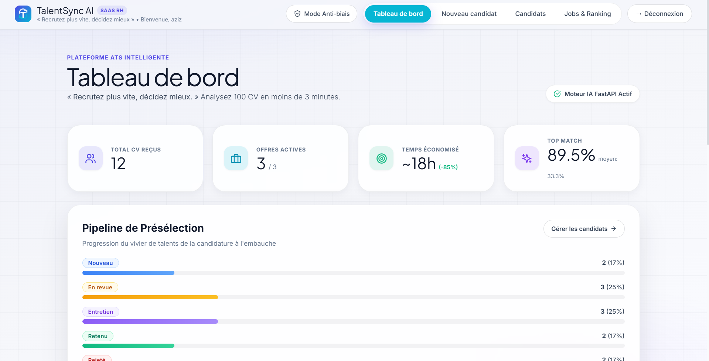
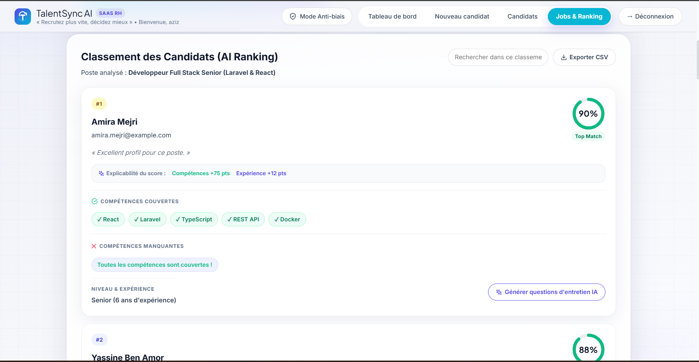
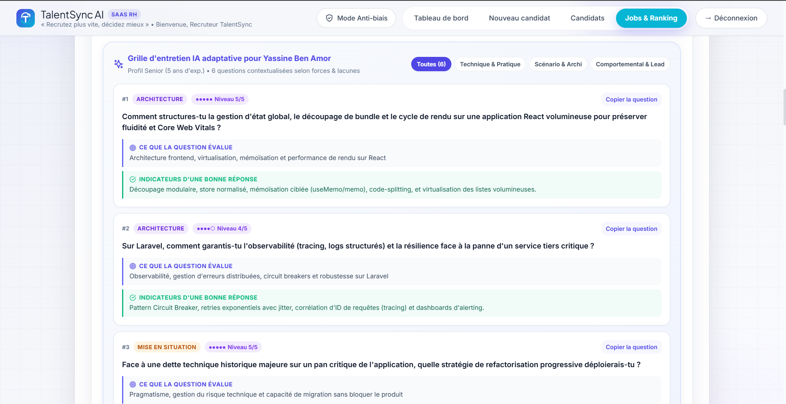
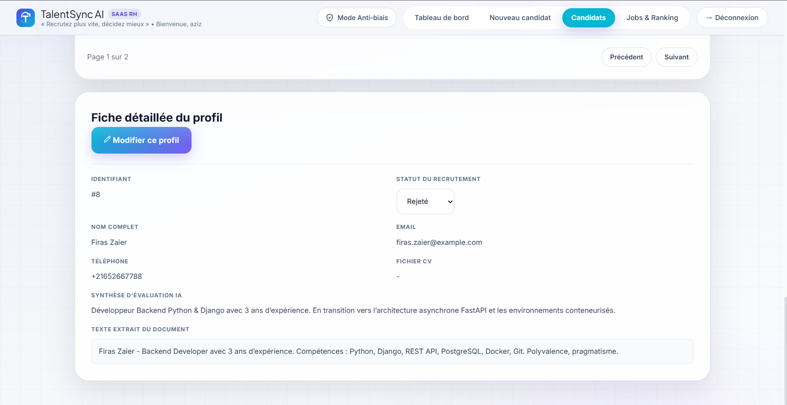
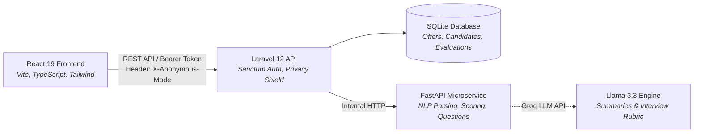

# TalentSync AI

**An Intelligent & Ethical Applicant Tracking System (ATS)**  
*Recruit faster, decide better.*

TalentSync AI is a modern applicant tracking system engineered to streamline resume screening, eliminate recruiter fatigue, and reduce unconscious bias through deterministic explainable scoring (XAI), server-side privacy-by-design anonymization, and adaptive technical interview preparation.

---

## Overview

A technical recruiter often reviews hundreds of resumes for a single opening. Manual screening takes 4 to 6 hours per job offer, is prone to decision fatigue, and is susceptible to cognitive bias.

TalentSync AI addresses this in four transparent steps:

1. **Ingest:** Multi-format parsing of PDF, DOCX, and TXT resumes with text extraction via PyMuPDF and python-docx.
2. **Analyze:** Automated profile extraction including technical skills, soft skills, languages, seniority level, and years of experience.
3. **Score:** Deterministic matching score (0 to 100%) against job descriptions with a mathematical breakdown of points earned and missing-skill penalties.
4. **Prepare & Decide:** Dynamic generation of level-calibrated interview questions, side-by-side candidate comparison, and candidate pipeline tracking.

> **Human-in-the-Loop Principle:** TalentSync AI acts as an objective decision-support tool. It never rejects a candidate automatically; hiring decisions remain 100% under human governance.

---

## Screenshots

| Dashboard & Pipeline Analytics | Job Offers & Deterministic AI Ranking |
|:---:|:---:|
|  |  |
| **Recruiter Dashboard with real-time pipeline KPIs** | **Deterministic XAI match score & point breakdown** |

| Adaptive Interview Question Grid | Candidate Pool & Anti-Bias Blind Mode |
|:---:|:---:|
|  |  |
| **Domain-filtered questions with interviewer evaluation rubric** | **Server-side anonymization concealing all PII** |

---

## System Architecture

The application is built on a decoupled, containerized three-tier microservice architecture:



| Service | Technology Stack | Port | Primary Responsibility |
|---|---|:---:|---|
| `frontend-react` | React 19, TypeScript, Vite | `5173` | Responsive UI, state management, bilingual localization (FR / EN) |
| `backend-laravel` | Laravel 12, PHP 8.4, Sanctum | `8080` | REST API, authentication, data persistence, server-side anonymization |
| `ai-service-fastapi` | FastAPI, Python 3.11, PyMuPDF | `8000` | Document parsing, skill extraction, deterministic XAI scoring, questions |

---

## Scoring Methodology (Explainable AI)

Rather than using opaque black-box vector embeddings where similarity yields an arbitrary scalar, TalentSync AI employs a transparent, deterministic scoring engine:

| Component | Weight | Implementation Details |
|---|:---:|---|
| **Hard-Skill Coverage** | **60 %** | Exact and normalized token-overlap matching against required competencies |
| **Experience Alignment** | **25 %** | Candidate seniority level vs. target job requirement, with bounded decay |
| **Secondary Technical Factors** | **15 %** | Relevant domain keywords and ecosystem proficiency |

Missing mandatory skills apply a bounded penalty (capped at 10 points) so that a single gap does not unfairly disqualify an otherwise stellar candidate. Every point is displayed itemized in the UI for complete hiring manager auditability.

---

## Adaptive Interview Question Generator

Interview questions are contextualized based on job title, verified seniority level, years of experience, matched skills, and identified skill gaps:

| Level | Max Difficulty | Core Evaluative Focus |
|---|:---:|---|
| **Junior** | 3 / 5 | Fundamentals, core concepts, learning agility, problem-solving reflexes |
| **Intermediate** | 4 / 5 | Production debugging, optimization, CI/CD, testing, code review trade-offs |
| **Senior** | 5 / 5 | System architecture, scalability, technical debt, trade-offs, engineering mentorship |

### Defensive Code Guardrails:
* **Pydantic Validation:** Strictly enforced schema across six question categories (`technical`, `practical`, `architecture`, `scenario`, `behavioral`, `leadership`).
* **Domain Coherence Filter:** Skills are mapped to categories (frontend, backend, data, devops). Cross-domain contradictions (e.g., asking about distributed CAP theorem on a React UI library) are automatically intercepted and replaced.
* **Guaranteed Cardinality:** Exactly six questions are returned per candidate. Missing slots are filled from level-appropriate templates; extraneous outputs are dropped.
* **Offline Resilience:** Deterministic template fallbacks trigger seamlessly if external LLM services are unreachable.

---

## Privacy-by-Design & Security

| Security Measure | Technical Implementation |
|---|---|
| **Server-Side Anonymization** | When Anti-Bias mode is enabled (`X-Anonymous-Mode: 1`), Laravel redacts candidate names, emails, and phone numbers before JSON serialization. No PII reaches the browser network tab. |
| **Resume Excerpt Scrubbing** | PII tokens (emails, phone numbers, URLs, candidate names) are regex-scrubbed before excerpts are processed. |
| **Prompt Injection Defense** | Untrusted resume text is isolated inside `<cv_data>` XML delimiter tags and treated strictly as raw data. |
| **Safe File Ingestion** | Allowed formats restricted to PDF, DOCX, and TXT (5 MB cap). Filenames are sanitized with unique random hashes. |
| **API Authentication** | State-managed token authentication via Laravel Sanctum. |

---

## Performance Benchmarks

All benchmarks are measured and reproducible via dedicated scripts in `ai-service-fastapi/`:

| Benchmark Protocol | Dataset & Execution Context | Throughput / Latency | Benchmark Script |
|---|---|:---:|---|
| **In-Memory Matching Engine** | 100 synthetic candidate profiles against comprehensive job requirements | **343.8 profiles / sec**<br/>*(0.29 s total, 2.89 ms mean)* | `benchmark_100_cv.py` |
| **Local End-to-End Pipeline** | 10 real multi-page CVs (PDF/DOCX parsing + NLP extraction + scoring) | **108.8 CVs / sec**<br/>*(0.09 s total, 9.2 ms / CV)* | `benchmark_e2e_10_cv.py` |

*Note: When remote LLM inference (Groq Cloud) is engaged for natural-language interview question generation, overall duration is governed by external API round-trip latency (~0.8s to 1.5s).*

---

## Quick Start

### Option A: Docker Compose (Recommended)

```bash
# Clone the repository
git clone https://github.com/aziz11414/TalentSync-AI.git
cd TalentSync-AI

# Build and start all three microservices
docker compose up --build
```

Services will be accessible at:
* **Web Application:** [http://localhost:5173](http://localhost:5173)
* **Laravel Backend API:** [http://127.0.0.1:8080](http://127.0.0.1:8080)
* **FastAPI Microservice Swagger Docs:** [http://127.0.0.1:8000/docs](http://127.0.0.1:8000/docs)

To stop services: `docker compose down`

---

### Option B: Local Execution (Windows 1-Click)

In the repository root, run:
```cmd
run.bat
```
or in PowerShell:
```powershell
.\run.ps1
```

---

## Pre-Loaded Demo Account

To evaluate the platform immediately with full data populated:

| Credential | Value |
|---|---|
| **Email** | `demo@talentsync.ai` |
| **Password** | `password` |
| **Demo Dataset** | **12 realistic candidate profiles** (Junior, Senior, DevOps, Full Stack) evaluated across 4 job openings with XAI scores. |

---

## Automated Testing

```bash
# Run FastAPI unit and integration tests (17 passing tests)
cd ai-service-fastapi
pytest tests -v

# Run deterministic scoring benchmark
python benchmark_100_cv.py

# Verify TypeScript type checks and build production bundle
cd ../frontend-react
npm run build
```

---

## Project Structure

```text
.
├── ai-service-fastapi/       # Python NLP parsing, scoring & question generator
│   ├── app/main.py           # Core FastAPI endpoints & Pydantic models
│   ├── benchmark_100_cv.py   # High-throughput in-memory benchmark
│   ├── benchmark_e2e_10_cv.py# Real-world end-to-end benchmark
│   └── requirements.txt      # Python dependencies
├── backend-laravel/          # Laravel 12 API, Sanctum auth, migrations & seeders
│   ├── app/Http/Controllers/ # REST controllers (Candidate, Job, Dashboard)
│   ├── app/Services/         # Synchronous HTTP client to FastAPI microservice
│   └── routes/api.php        # API routes with X-Anonymous-Mode handling
├── frontend-react/           # React 19 SPA with TypeScript & Vite
│   ├── src/components/       # Reusable UI widgets (ScoreGauge, LanguageSwitcher, etc.)
│   ├── src/context/          # LanguageContext with localStorage persistence
│   ├── src/i18n/             # Complete French / English translations dictionary
│   ├── src/pages/            # Dashboard, Candidates, Jobs & Ranking, CreateCandidate
│   └── src/utils/            # Contextual summary & badge translators
├── screenshots/              # High-resolution application screenshots
├── docker-compose.yml        # Multi-container service definitions
├── run.bat / run.ps1         # Windows one-click local startup scripts
├── LICENSE                   # Proprietary evaluation license
└── README.md                 # Technical documentation
```

---

## Author & Copyright

**Mohamed Aziz Hammami**  
*Master 2 — Applications Web Intelligentes (ISI Kef)*  
GitHub: [@aziz11414](https://github.com/aziz11414)

### License & Intellectual Property
Copyright © 2026 **Mohamed Aziz Hammami**. All rights reserved.  
This project and its source code are made available strictly for assessment, technical evaluation, and academic review by hiring teams, recruiters, and examiners. Unauthorized reproduction, redistribution, or commercial use is strictly prohibited. Refer to [LICENSE](LICENSE) for full legal terms.
